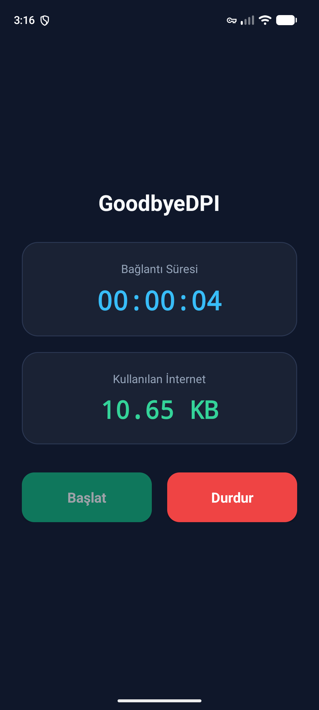
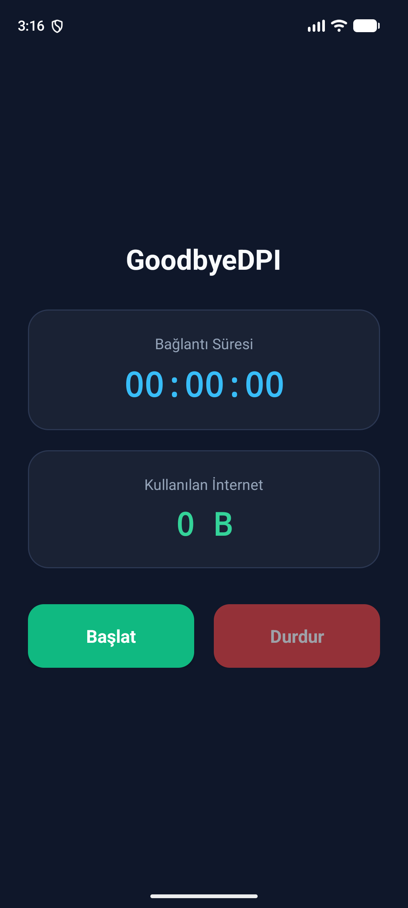

# GoodbyeDPI Mobile (Türkiye Sürümü — Android)

**GoodbyeDPI Mobile**, Türkiye'deki İnternet Servis Sağlayıcılarının (İSS) uyguladığı DNS engellemelerini ve Derin Paket İnceleme (DPI) sistemlerini **root yetkisi gerektirmeden** Android cihazlarda aşmak için geliştirilmiş yerel (C/JNI + Kotlin `VpnService`) mobil uygulamadır.

Asıl proje olan [ValdikSS/GoodbyeDPI](https://github.com/ValdikSS/GoodbyeDPI) ve [GoodbyeDPI-Turkey (`v0.2.3rc3-turkey`)](https://github.com/cagritaskn/GoodbyeDPI-Turkey) C kaynak kodlarının Android NDK (`Clang`) ile yerel `.so` kütüphanelerine (`arm64-v8a` ve `x86_64`) derlenmesi ve Android'in yerleşik `VpnService` altyapısına entegre edilmesiyle oluşturulmuştur.

---

## 📱 Doğrudan APK İndirme ve Kurulum

Hazır derlenmiş Android paketini doğrudan telefonunuza indirip kurabilirsiniz:

- 📦 **[GoodbyeDPI-Mobile.apk İndir (Releases)](../../releases/latest)**
- 📂 Depo içi doğrudan bağlantı: [`releases/GoodbyeDPI-Mobile.apk`](releases/GoodbyeDPI-Mobile.apk)

### Kurulum ve Kullanım Adımları
1. `GoodbyeDPI-Mobile.apk` dosyasını Android cihazınıza indirin ve yükleyin.
2. Uygulamayı açın ve **Başlat** butonuna dokunun.
3. İlk çalıştırmada Android sisteminin gösterdiği VPN bağlantı iznini onaylayın (bu izin gerçek bir uzak VPN sunucusuna bağlanmak için değil, paketlerin cihaz içinde yerel C motorundan geçirilmesi için kullanılır; hız kaybı yaşanmaz).
4. Ekranda anlık **Bağlantı Süresi** (`00:00:00`) ve **Kullanılan İnternet** (`B / KB / MB / GB`) miktarını takip edebilirsiniz.
5. Kapatmak istediğinizde **Durdur** butonuna dokunmanız yeterlidir.

---

## 🖼️ Ekran Görüntüleri

| Çalışıyor Durumu (DPI Atlatma Aktif) | Durduruldu Durumu |
| :---: | :---: |
|  |  |

---

## ⚙️ Teknik Mimari ve Çalışma Prensibi

Windows üzerinde çalışan `GoodbyeDPI`, çekirdek seviyesinde `WinDivert` sürücüsünü kullanır. Android işletim sisteminde ise root gerektirmeden paket yakalama ve DPI atlatma işlemi aşağıdaki hibrit mimari ile gerçekleştirilir:

1. **Yerel C/JNI Çekirdeği (`libgoodbyedpi_turkey.so`)**:
   - `app/src/main/cpp/` dizininde yer alan orijinal `GoodbyeDPI-Turkey` C modülleri (`goodbyedpi_jni.c`, `dnsredir.c`, `ttltrack.c`, `blackwhitelist.c`, `utils/repl_str.c`) Android NDK kullanılarak `arm64-v8a` (fiziksel telefonlar) ve `x86_64` (emülatörler) mimarileri için derlenmiştir.
   - **TLS ClientHello SNI Ayrıştırma ve Parçalama (`extract_sni` & `-e 2` / `--frag-by-sni`)**: Giden HTTPS bağlantılarında TLS `ClientHello` paketini yakalar, `SNI` (Server Name Indication) alanını tespit eder ve paketi DPI cihazlarının birleştiremeyeceği şekilde küçük TCP segmentlerine (`TCP_NODELAY`) bölerek gönderir.
   - **Firefox 130 Sahte Paket Üretimi (`fakepackets.c`)**: Orijinal `GoodbyeDPI-Turkey` içerisindeki TLS 1.2/1.3 `ClientHello` şablonunu kullanarak DPI yanıltma paketleri oluşturur.
   - **HTTP Başlık Manipülasyonu (`-r`, `-m`, `-s`, `-f 2`)**: `Host:` başlığını `hoSt:` olarak değiştirir, alan adı harflerini büyük/küçük (`eXaMpLe.cOm`) karıştırır ve ilk 2 baytı parçalayarak gönderir.
   - **Pasif DPI ve QUIC/HTTP3 Engelleme (`-p`, `-q`)**: İSS tarafından enjekte edilen sahte `HTTP 302` yönlendirme paketlerini ve UDP 443 üzerindeki `QUIC Initial` paketlerini düşürerek tarayıcıların parçalanabilir TCP/TLS 1.3 bağlantısına geçmesini sağlar.

2. **DNS Yönlendirme (`dnsredir.c` — Türkiye İSS Bypass)**:
   - Türkiye'deki birçok İSS standart 53 numaralı porttaki DNS isteklerini engellediği veya şeffaf vekil sunucu ile yönlendirdiği için, `GoodbyeDpiVpnService` sanal TUN arayüzüne (`10.215.173.1/30`) gelen DNS paketlerini yakalar ve `VpnService.protect()` korumalı UDP soketleri üzerinden **Yandex DNS (`77.88.8.8` Port `1253`)** adresine (ve yedek olarak `1.1.1.1:53`) yönlendirir.

3. **Sade Arayüz**:
   - Kullanıcı arayüzünde karmaşık ayarlar yerine yalnızca **Başlat** ve **Durdur** butonları ile gerçek zamanlı **Bağlantı Süresi** ve **Kullanılan İnternet** sayaçları yer alır.

---

## 📂 Proje Dizin Yapısı

```text
GoodbyeDPI-Mobile/
├── app/
│   ├── src/
│   │   ├── main/
│   │   │   ├── cpp/                         # GoodbyeDPI-Turkey C/JNI kaynak kodları
│   │   │   │   ├── goodbyedpi_jni.c         # JNI köprüsü ve paket işleme fonksiyonları
│   │   │   │   ├── dnsredir.c / .h          # UDP DNS bağlantı izleyici
│   │   │   │   ├── ttltrack.c / .h          # TCP SYN/ACK Auto-TTL hesaplayıcı
│   │   │   │   ├── blackwhitelist.c / .h    # Alan adı filtreleme modülü
│   │   │   │   └── utils/                   # repl_str, getline, uthash
│   │   │   ├── jniLibs/                     # Derlenmiş yerel Android kütüphaneleri (.so)
│   │   │   │   ├── arm64-v8a/libgoodbyedpi_turkey.so
│   │   │   │   └── x86_64/libgoodbyedpi_turkey.so
│   │   │   ├── assets/goodbyedpi-turkey-src/# Orijinal GoodbyeDPI-Turkey kaynak arşivi
│   │   │   ├── java/com/goodbyedpi/turkey/
│   │   │   │   ├── MainActivity.kt          # Başlat/Durdur, Bağlantı Süresi ve İnternet Sayacı UI
│   │   │   │   ├── GoodbyeDpiVpnService.kt  # Android VpnService & Yerel DPI Desync Vekil Sunucusu
│   │   │   │   └── GoodbyeDpiEngine.kt      # Kotlin <-> C JNI DPI Motoru
│   │   │   └── res/                         # Arayüz XML tasarımları (activity_main.xml)
│   │   ├── test/                            # JUnit 4 Birim Testleri (GoodbyeDpiEngineTest.kt)
│   │   └── androidTest/                     # Cihaz/Emülatör Enstrümantasyon Testleri
├── docs/screenshots/                        # Uygulama ekran görüntüleri
└── releases/GoodbyeDPI-Mobile.apk           # Kuruluma hazır APK dosyası
```

---

## 🛠️ Kaynak Koddan Derleme ve Testler

### Gereksinimler
- **JDK 17+** (veya JDK 21)
- **Android SDK** (`compileSdk 36`, `minSdk 24`)
- **Android NDK** (`28.x` — `.so` kütüphanelerini yeniden derlemek isterseniz)

### APK Derleme
```bash
./gradlew assembleDebug
```
Çıktı APK dosyası: `app/build/outputs/apk/debug/app-debug.apk`

### Birim ve Enstrümantasyon Testlerini Çalıştırma
```bash
# JVM Birim Testleri (SNI ayrıştırma, TLS parçalama, HTTP hoSt dönüşümü, QUIC/DPI tespiti)
./gradlew testDebugUnitTest

# Açık bir Android cihaz veya emülatör üzerinde UI ve JNI testleri
./gradlew connectedDebugAndroidTest
```

---

## ⚠️ Yasal Uyarı

> [!IMPORTANT]
> Bu uygulamanın kullanımından doğan her türlü yasal sorumluluk kullanan kişiye aittir. Uygulama yalnızca eğitim, ağ güvenliği ve araştırma amaçları ile yazılmış ve düzenlenmiş olup; bu uygulamayı bu şartlar altında kullanmak ya da kullanmamak kullanıcının kendi inisiyatifindedir.
